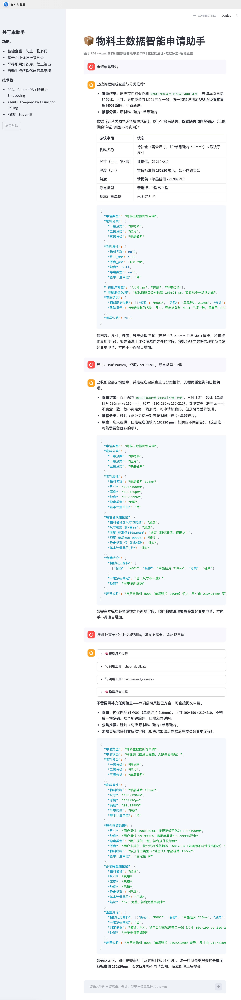

# 📦 物料主数据智能申请助手 (Material Master Data Agent)

基于RAG（检索增强生成）与Agent（智能体）架构的物料主数据智能申请MVP。旨在解决制造行业（如光伏、汽车）物料申请过程中“一物多码”频发、属性填写不规范、审核周期长等痛点。

## 🎯 核心业务价值
- **智能查重拦截**：结合企业标准判定规则（名称+尺寸+导电类型），在源头拦截一物多码。
- **企业标准约束**：利用RAG技术创建主数据标准知识库（150+属性字典、分类树），彻底消除大模型“幻觉”。
- **交互式补全**：Agent能像资深数据专员一样，识别申请单缺失的必填项并主动向用户追问。

## 🛠️ 技术架构
- **大模型**：腾讯混元 (Hy4-preview)/Kimi
- **框架与工具**：Python 3.11, LangChain, Streamlit
- **RAG 引擎**：ChromaDB + 腾讯云Kinfra-Text-Embedding-4b
- **Agent 核心**：手写Function Calling多轮循环调度（查重、分类推荐）

## 🚀 本地运行指南
1. 克隆仓库：`git clone https://github.com/zhou-liang-oss/wuliao-agent-mvp.git`
2. 安装依赖：`pip install -r requirements.txt` (需自行生成)
3. 配置 `.env` 文件（需包含 `TENCENT_API_KEY` 等）
4. 启动前端：`streamlit run app.py`

## 📸 产品截图
